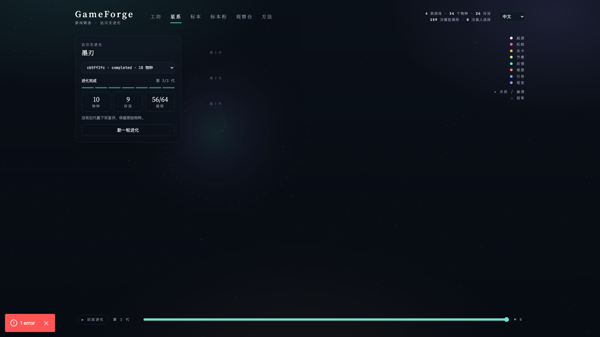
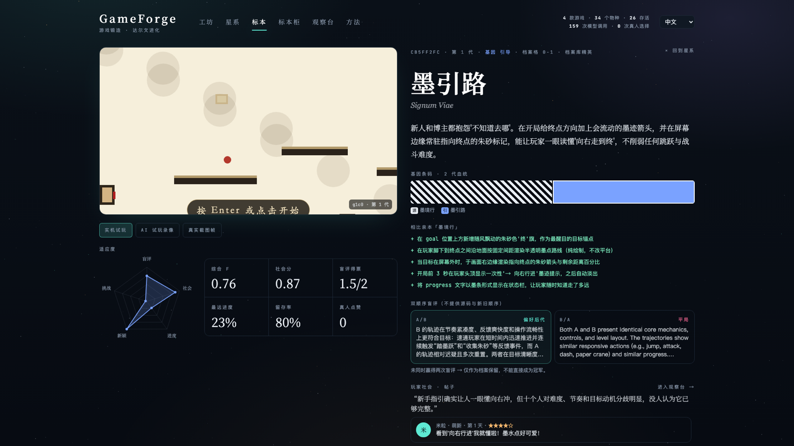
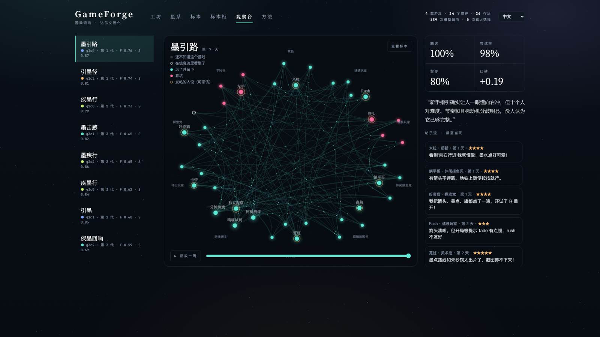

# 达尔文进化（Darwin Evolution）

GameForge 负责「一句话 → 可玩游戏」，达尔文进化在此基础上让游戏自己繁衍。它不另起一套评估体系，而是让每一个后代都走 GameForge 已有的「制作 → 试玩 → 评审」流水线，再加上「游戏达尔文引擎」的种群进化、MAP-Elites 档案库、模拟玩家社会和进化博物馆式界面。

<div align="center">
  
</div>

## 一代是怎么产生的

| 阶段 | 做什么 | 实现 |
|---|---|---|
| 制作 | 每代 N 个（默认 4）DeepSeek Harness（dsh）制作组并行工作。每组 fork 一个亲本到自己的目录，先读这一版本收到的真实评价（`REVIEWS.md`），再读血统里每一代的改动和得分（`HISTORY.md`），然后自己决定改什么：可以重画、改玩法、加关卡，也可以推倒重来，**不设改动上限**。制作组会反复运行 `worker/playtest.py` 自测，用 `read_image` 看自己游戏的截图再改。交付时写 `SUBMISSION.json`，内容包括物种名、主要改动方向、改了什么、回应了哪几条评价。静态门槛（单文件、GameAgentBridge、`node --check`）不过，就打回去修一次 | `worker/studio.py`，`Evolution.run_studios / fork / adopt` |
| 试玩 | 与单候选改进共用同一个隔离运行时和数据型 JSON 按键策略；每个物种 3 局，分别由萌新、速通、探索三种人设各打一局 | `Run.play(purposes=…)` |
| 严苛评审 | 由 `deepseek-flash`（V4.1，支持看图）评审，它看真实试玩截图和按键轨迹，按固定标准给 6 项各打 1–10 分：新意、画面、手感、反馈、清晰、深度。同时列出 5–10 条问题，每条都附证据和具体改法。标准里有硬性封顶：套路玩法新意 ≤3；代码统计显示主体是方块、圆形时画面 ≤3；运行报错、画面冻结或角色坐标从不变化时全部 ≤2。封顶由代码按测量值执行，不靠模型自觉 | `Evolution.critique`，`worker/standard.py`，`worker/artstats.py` |
| 盲评 | 与亲本做 A/B、B/A 两次盲评，不提供源码和新旧顺序。评审先给双方各 6 项打 1–10 分，结论由分数推出：总分领先 ≥3 才算赢，否则平局。引用必须是证据清单里真实存在的路径 | `Run.review` + `rubric_winner` |
| 社会 | 10 类玩家人设（萌新、速通、硬核、休闲、剧情、美术、博主、怀旧、探索、手残）依据真实轨迹和截图发帖、打分、决定弃坑与否；之后在 40 人关注图上做 7 天确定性口碑扩散，得到触达、尝试率、留存和口碑 | `Evolution.society / diffuse`，`worker/personas.json` |
| 选择 | 计算适应度，写入 MAP-Elites 档案（挑战度 × 进度，各 3 档）；下一代亲本从档案精英中锦标赛选出 | `score / pick_parents` |

适应度：`F = 0.35·评审 + 0.15·盲评 + 0.25·社会 + 0.10·进度 + 0.15·新意`

- **评审**：严苛评审 6 项平均分 / 10。
- **盲评**：后代在两次盲评中的得票，除以 2。
- **进度**：取游戏 `observe()` 报告的最远进度或胜利，不采信模型自报。
- **新意**：0.7 × 评审给的新意分 + 0.3 × 档案库里同类改动方向的稀有度。

**评价账本**：每个物种评完后，以下内容原文写进 `ledger/<物种>.json`：评审意见、10 条玩家帖子、盲评理由、试玩报错和测量数据。fork 它的制作组拿到的 `REVIEWS.md` 就是这份账本的原文，低分帖排在前面。提示词里只有固定的技术约定和工作方式，**没有任何预设的改进方向**。

**冠军规则（沿用 GameForge 的保守保留）**：只有原始物种，或两次盲评都偏好后代、且引用了有效证据的物种，才能成为冠军。其余物种可以繁衍、可以被试玩，但只作为档案保留。

**崩溃修复**：原版如果在真实试玩中抛出运行时错误，系统会把报错、栈信息和试玩证据交给一个 dsh 修复组。修好并通过试玩的版本（`s0r`）成为新的根。崩溃的原版和修复后的版本没有可比性，所以这一步不做盲评。

## 界面

视觉语言是游戏菜单式的波普风格：信号红底、黑白面板、3px 黑色描边与硬投影、斜切按钮和标签、网点纹理，谱系图放在黑色舞台上，冠军用黄色爆炸星标出。字体为 Noto Sans SC Black（中文标题）、Anton（数字与英文标题）、Barlow / Barlow Condensed（正文与标签）和 JetBrains Mono（编号）。

物种名不预设风格：命名提示词要求名字贴合该游戏自己的世界观、类型和语气（像补丁代号或游戏世界里的生物名），除非游戏本身是古风或水墨题材，否则不使用古典、诗词或武侠腔；仿拉丁学名保留。

| 页面 | 内容 |
|---|---|
| 工坊 | 原 GameForge 的生成控制台和分步流程。勾选「生成后立即开始达尔文进化」，一键生成完成后会自动开始进化 |
| 谱系 | 径向族谱：中心是第 0 代，半径是代数，颜色是基因（矿物颜料色）。悬停任一物种，血缘会被墨线加粗并回溯到原点；冠军外圈是朱砂双环；× 表示夭折或崩溃；底部时间轴可以回放进化。进化进行时会实时出现「胚胎」 |
| 标本 | 沙盒 iframe 实机试玩、AI 试玩录像、真实截图帧、五维适应度雷达、基因条码、相比亲本的改动、双顺序盲评理由、玩家帖子；可以「♥ 自然选择它」、选用此版本（会检查编辑冲突）、导出离线 ZIP |
| 标本柜 | MAP-Elites 3×3 档案，每格展示该生态位的精英和它的真实截图 |
| 观察台 | 40 人关注网络的一周口碑回放、帖子流；点任意人设即可**采访**，回答基于该人设的帖子和真实试玩事实 |
| 方法 | 流程图、适应度公式、进化曲线、真人校准（模拟社会分与真人点赞的 Spearman 相关；样本不足时不计算）、诚实边界 |

<div align="center">
  
  
</div>

## 运行

```bash
pnpm install   # 或 npm install
cp .env.example .env.local   # 填写 DEEPSEEK_API_KEY（或 QWEN_API_KEY）
pnpm dev
```

Linux 服务器按 [IMPROVEMENT.md](IMPROVEMENT.md) 配置 Docker 运行时。

**没有 Docker 的开发机（macOS / Windows）**：可以显式启用本机 Chromium 沙箱。

```bash
python3.11 -m venv .venv-worker
.venv-worker/bin/pip install playwright==1.60.0 jsonschema==4.26.0
.venv-worker/bin/python -m playwright install chromium-headless-shell ffmpeg
# .env.local
GAMEFORGE_RUNTIME=local
GAMEFORGE_PYTHON=/absolute/path/to/.venv-worker/bin/python
```

本机沙箱的隔离方式和局限：

- 冻结的游戏只从一个私有回环端口只读提供；除该源之外的所有请求一律中止。
- 禁用 Service Worker、下载和权限；保留 Chromium 渲染器沙箱。
- 游戏拿不到任何密钥、运行目录或其他项目。
- 它弱于 Docker 容器，每张试玩回执都会记录 `runtime.mode = local-chromium-sandbox`，「方法」页也会显示。

默认预算为 3 代，每代 4 个制作组，每组最多 25 分钟。评审侧每个后代约 5 次调用（试玩策略、严苛评审、2 次盲评、社会推演），上限 160 次，总时长上限 300 分钟。所有调用都**开启思考模式**（`reasoning_effort=high`，`max_tokens=64000`）。输出被截断时直接报错，不会静默接受；JSON 格式出错时会显式纠正一次。需要看图的调用一律用 `deepseek-flash`，因为 `deepseek-v4-pro` 不支持图片输入。

**dsh 制作组**需要安装 DeepSeek Harness，三种方式任选：`npm i -g @deepseek-ai/dsh`；装在项目内 `.tools/dsh`（已 gitignore）；用 `GAMEFORGE_DSH` 指向可执行文件。dsh 走 DeepSeek 的 Anthropic 兼容接口，所以制作组不继承 `DEEPSEEK_BASE_URL`，需要自定义时用 `GAMEFORGE_DSH_BASE_URL`。没有 dsh 时，退回单次调用的旧制作方式，同样不设编辑条数上限。设置 `GAMEFORGE_STUDIO=single` 可以强制关闭第 0 代的制作组。

**第 0 代也由制作组完成**：一句话生成横版游戏时，设计文档出来后，由一个 dsh 制作组从零写游戏、自测、看截图。交付后，严苛评审看它自己的截图给出真实意见，制作组再按意见修改一轮。设计提示词也改为少而精：1–2 关，每关一个非套路的核心机制，2–4 种行为不同的敌人。

## 接口

| 接口 | 用途 |
|---|---|
| `POST /api/improve/:game` `{kind:"evolve", budgets:{generations, children, calls, minutes}}` | 启动进化（停止和恢复沿用 `/api/improve/:game/:run`） |
| `GET /api/evolve/:game` | 该游戏的全部进化、物种、证据帧、人设与点赞 |
| `GET /api/evolve` | 全局统计 |
| `GET /api/species/:game/:run/:sid/index.html` | 进化中物种的沙箱预览，带 CSP 并校验源码哈希 |
| `POST /api/evolve/:game/:run/like` | 真人「自然选择它」 |
| `POST /api/evolve/:game/:run/interview` | 采访模拟玩家 |

## 稳健性

以下几种异常都按「失败记录在案」处理，不会让整轮进化中止，也不会重复计费：

- 模型返回的 JSON 后面带了多余文字，只解析第一个对象。
- 制作组交付没过静态门槛：带着具体报错打回同一个 dsh 会话修一次，还不过就记为夭折。
- 制作组超时：到 `teamMinutes` 时终止进程，用目录里现有的版本去过门槛。
- 设计输出的键名被翻译成中文时会自动映射回英文键。
- 试玩策略里的按键时长会被截断到 16–1000 ms，所有调整次数写进回执。
- 已派发但没有收到响应的调用，不会自动重复派发，对应的胚胎记为夭折。

## 真实进化记录（2026-11-24，DeepSeek，本机沙箱）

| 游戏 | 代数 | 物种 | 存活 / 夭折 / 崩溃 | 调用 | 最高 F | 冠军 | 盲评票（后代 / 亲本 / 平 / 无效） |
|---|---:|---:|---|---:|---|---|---|
| 霓虹雨夜：机械猫 | 2 | 6 | 4 / 1 / 1 | 23 | 疾风 0.646 | 修影（原版崩溃后的修复版） | 3 / 1 / 0 / 2 |
| 深海灯笼鱼：深渊之光 | 3 | 10 | 7 / 3 / 0 | 44 | 幽光脉冲 0.715 | 灯笼渊（原版） | 1 / 1 / 8 / 2 |
| 墨刃 | 3 | 10 | 9 / 0 / 1 | 56 | 墨引路 0.759 | 墨境行（原版） | 3 / 0 / 13 / 0 |
| 发条鸟的蒸汽之旅 | 3 | 8 | 6 / 0 / 2 | 36 | 导引齿轮 0.742 | 锈齿试炼（原版崩溃后的修复版） | 2 / 0 / 8 / 0 |

结果说明：

- 4 款由模型生成的游戏里，有 2 款原版一开局就在真实试玩中崩溃（`p is not defined` 等），都由一次修复突变救活。
- 没有任何后代同时赢下两次盲评，所以冠军都是原版或修复版。
- 前几轮评审曾表现出明显的「偏好 B 位」倾向，双顺序规则拦住了它。改为评分推出结论后，同一对证据在两种顺序下都得到一致的平局，说明这些后代与亲本的差异确实很小。
- 这些都是代理指标，没有开展真人实验。

## 诚实边界

- 模型评审和模拟社会都是代理信号，不等于真人觉得好玩。
- 每局最多 24 个动作，策略按物种重新学习，不是严格的控制变量实验。
- 社会层的帖子由一次模型调用生成，扩散过程是确定性模型；采访回答由 LLM 扮演，界面明确标注「模拟玩家 · LLM 扮演」。
- 进化当前面向独立 HTML / Canvas 横版游戏；文字冒险仍走原有的生成与导出流程。
